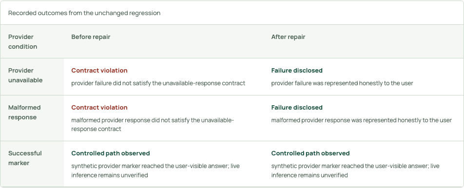

# Integration Verifier

Check whether an AI provider actually participates in the answer a user sees. Run controlled failure and marker conditions against a bundled Node app, inspect browser evidence, and compare the same tests before and after a local repair.

This repository contains this product and its required shared modules only. It runs independently of the original four-project suite.

## Run

Requires Node.js 22 or newer. Install the pinned dependencies, then start the loopback-only server:

```sh
npm ci
npx playwright install chromium
npm start
```

Open `http://127.0.0.1:4190/` for the landing. The same landing is available at `/products/verifier`; the working UI is at `/verifier`. `DESK_PORT` changes the port. `DESK_WORKSPACE` selects the parent directory of local projects where applicable. Managed records are stored beneath `work/desk` in that workspace; keep this directory private and outside version control.

## Current sponsor workflow

Nemotron proposes a repair from the bundled sample and its contract. Token Factory Sandbox executes generated code against unchanged browser checks. Tavily retrieves provider documentation; selected passages feed a separately reviewed Nemotron contract checklist.

Live requests use explicit consent, bounded inputs and a default-deny free-usage guard. See [sponsor setup and receipt boundaries](SPONSORS.md), [recording plan](demo/storyboard.md), and [current release validation](RELEASE-VALIDATION.md). The existing product captures below are historical local observations, not proof of the new sponsor workflow.

## Verify

```sh
npx playwright install chromium
npm test
```

The browser installation is required for browser tests and the actual controlled verifier. An already installed browser can instead be selected with `PLAYWRIGHT_CHROMIUM_EXECUTABLE_PATH`. `npm run test:smoke` checks the standalone landing, working UI, evidence assets, session protections, denied sibling routes and unconfigured inference. Tests use local fixtures; no live provider credentials are required. Avoid supplying credentials while testing.

See [selected validation](VALIDATION.md) for the current check scope and results.

## Scope and boundaries

Inspect bundled Node samples under unavailable, malformed and marker provider conditions. Local deterministic repair runs an unchanged regression in a temporary copy. Only trusted bundled samples run locally; arbitrary repositories are unsupported. Optional generated repair and Token Factory Sandbox execution require separately verified access, explicit consent, and configuration. Sandbox adapter dependencies are pinned in requirements-sandbox.txt; install them in a private virtual environment only when intentionally configuring that optional capability.

No live inference or remote execution was performed by this checkout’s fixture tests; verify release-specific sponsor evidence separately. `.env.example` lists only this product's optional settings. Never commit `.env`, tokens, runtime records or user-selected project files. The server checks exact local Host/Origin, requires a session token for APIs, bounds request size, and serves only explicit static assets. Sibling product pages and APIs are absent.

## Product capture



Actual local repair comparison; controlled provider conditions, not live sponsor inference.

## Evidence and tests retained

The landing screenshots are actual controlled local UI captures with textual alternatives and image failure fallbacks. JSON evidence is synthetic/controlled and carries its observation limits. The Verifier comparison is a sanitized derived projection, not the original primary report; its original hash identifies the upstream report, which is intentionally not included here.

Product unit/service/browser suites and shared inference-runtime tests are retained. Relevant readiness and workflow browser cases were split by product without changing their assertions.  Cross-product hub, marketing, motion, and shared multi-product browser suites are omitted; their route assumptions do not apply to a standalone repository. The standalone smoke suite covers the new server boundary. Historical private audit/output directories and old Git history are intentionally absent.

MIT licensed; the bundled self-hosted Manrope font license is in `src/desk/public/fonts/LICENSE.txt`.
